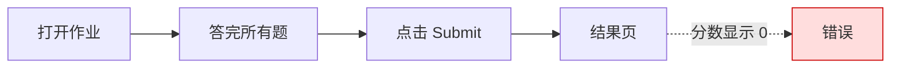
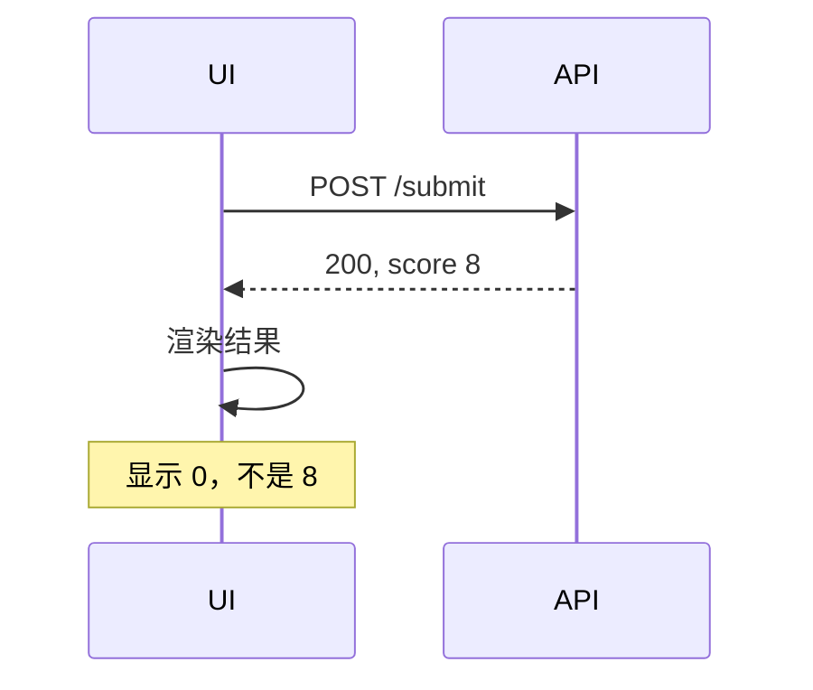
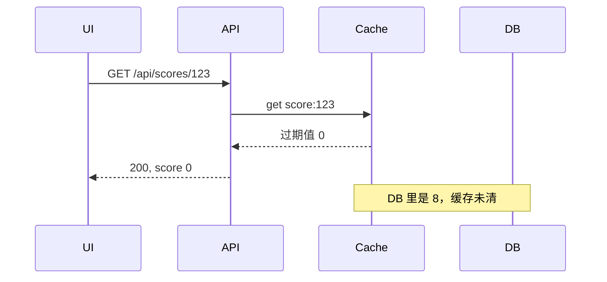
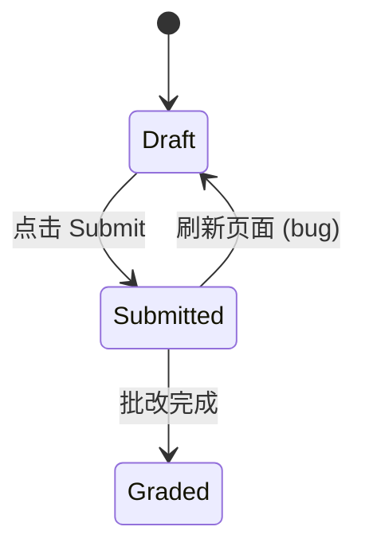
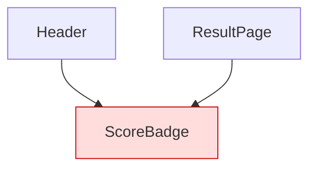

# 图示模板

按单要说明的点选一个模板，把标签换成来源里的事实。每张图不超过 12 个节点，节点标签 1–4 个词，用单的语言（双语单用英文标签）。来源：官方 `kira-apac-issue-intake` v3.0 `references/visuals.md`，加上 Kira 设计侧的两栏对照和设计差异表。

## 截图或录屏

```markdown

```

问题区域在大截图里很小时，图下加一行告诉读者看哪里，例如 `右上角分数徽标。`，不多写。

## 实际与预期（设计还原首选）

实际 = staging 截图；预期 = Figma MCP `get_screenshot` 导出的对应节点。两张图都先放 scratchpad，建单后上传 Linear。

```markdown
| 实际 | 预期 |
| --- | --- |
|  |  |
```

导出 Figma 图时：
- 截同一个状态、同一个 viewport 宽度，和实际截图对齐范围。
- 节点太大时截到问题所在的子节点，不截整页。
- 拿不到预期图：Figma 链接放进 `References`，正文写 `预期：见 Figma`。

## 设计差异表

数值差异放表格，不写成段落。只列不一致的属性。

```markdown
| 属性 | 实际 | 预期 | Token / Figma node |
| --- | --- | --- | --- |
| padding-top | 12px | 16px | `spacing/4` · 123:456 |
| 标题字号 | 18px / 600 | 20px / 600 | `heading/sm` · 123:460 |
| 主按钮背景 | `#3B82F6` | `#2563EB` | `color/primary/600` · 123:470 |
| hover 状态 | 无变化 | 背景加深 | `color/primary/700` · 123:471 |
```

- 实际值来自 staging 实测或固定 commit 的代码；写明是哪一种（§13.6 证据层级）。
- 预期值来自 Figma 变量或节点属性；有 token 就写 token 名。
- 状态类差异（hover、focus、disabled、空状态、加载、报错）同样放这张表。

## 用户步骤或系统调用

用户操作步骤用 `flowchart LR`，标出出错的那一步。



UI 和其他系统之间的调用顺序是重点时，用 `sequenceDiagram`。



## UI、接口、数据库、缓存之间的调用

用于 BE Bug，或两层都有问题的情况。错误的值写在箭头上或 Note 里。



## 请求和返回

```markdown
| 请求 | 状态码 | 字段 | 实际 | 预期 |
| --- | --- | --- | --- | --- |
| `POST /api/submit` | 200 | `score` | `0` | `8` |
```

## 日志或 trace 节选

不超过 15 行。保留报错行和说明原因的几行。去掉 token、cookie、邮箱和其他个人信息。

````markdown
```text
2026-10-14T10:02:11Z ERROR grading.submit: KeyError 'rubric_id'
  at grading/service.py:88 in compute_score
```
````

## 状态切换错误



在错误的转换上标 `(bug)`。问题没涉及的状态不画。

## 波及的页面或组件



条目之间没有关系时改用表格。共用组件改动必须写出波及范围。

## 取值、环境或角色

```markdown
| 角色 | staging | production |
| --- | --- | --- |
| teacher | 正确 | 正确 |
| student | 显示 0 | 正确 |
```

## 设计子任务 / 设计同步

要补的状态清单：

```markdown
| 状态 | 现有设计稿 | 要做 |
| --- | --- | --- |
| 空状态 | 无 | 补 |
| 加载 | 有（123:456） | 不改 |
| 报错 | 无 | 补 |
```

设计同步（前端已改、设计稿要跟上）：

```markdown
| 前端现状 | 当前设计稿 |
| --- | --- |
|  |  |
```
