# Speak Aloud 设计走查 · R1 报告

- 来源：Slack [#apac-product-feedback](https://kiralearning.slack.com/archives/C0C2J6GNP41/p1792658296631009) · Linear [APACUIX-466 [Speak Aloud] 设计走查汇总](https://linear.app/kira-learning/issue/APACUIX-466)
- 设计稿：[Question Library / Speak Aloud](https://www.figma.com/design/WLKOeNoCrS33jWIpbjcE9h/Question-Library?node-id=11436-35232)（Teacher Editor、Teacher Preview、Student、Teacher Grading 四个 section）
- PRD：[Add Speak Aloud blank questions to General Assessment](https://app.notion.com/p/3e270a1b99248169bd37fb0eec960a5e)
- 走查时间：2026-10-22 18:00–18:50（UTC+8），staging，Chrome 156，视口 1440×900
- 范围：老师端（编辑页、Preview、Monitor 作答抽屉、批改页）+ 学生端（作答、成绩页），按 issue 说明「不限页面，老页面有问题也提」

## 结论

共 20 条问题：中 8 条，低 12 条（其中 #7、#12、#17、#18 需要先和 PM / 设计确认口径）。另有 2 张已提单在 staging 上复测已修复。

最值得先处理的 3 件事：

1. **Language 标签 5 个页面 4 种样子**：编辑页灰底 13px、Preview / 学生作答白底描边、学生成绩页 / Monitor 抽屉蓝底白字、批改页灰底 12px（只有批改页和设计一致）。设计稿所有页面都是灰底 `#F4F4F5`、12px、无描边。→ #1
2. **断网时录音卡在 Processing**：断网 45 秒以上一直显示 `Processing... Saving your recording. You can't record again until this finishes.`，不能重录，也没进入 PRD 的「录音存在本机」状态；联网后 0.5 秒内补交成功。→ #13
3. **Monitor 作答抽屉没有复用成绩页题卡**：目标文本拆成一个个词块、标签写 `Expected Text`；PRD 要求和学生成绩页同一张卡（整句纯文本、`Text for Students to Speak`）。→ #19

## 测试数据

| 项 | 内容 |
| -- | -- |
| 老师账号 | Luke Larkin（teacher1-design-test，账号见 Notion「How to log into staging with test accounts」） |
| 测验 | `Copy - Kindergarten Math: Counting, Shapes & Patterns`（复制后删到只剩 2 道 Speak Aloud：Q1 Spanish `El perro corre en el parque.`，Q2 English `The cat sat on the mat.`） |
| 编辑页 | https://staging.kira-learning.com/ai-tools/assessment/edit/01a16311-1b09-758f-94a8-b0bb6e9a43a8/ |
| 布置 1（AI Grading） | `Speak Aloud Design QA 1022`，code `9Z66F7`，Monitor：https://staging.kira-learning.com/ai-tools/assessment/session/01a16321-ceae-75f2-8ea3-8217d1448de8/ |
| 布置 2（Manual Grading） | `Speak Aloud QA Manual`，code `AKC8GC`，只布置给 Hwa，用来看「报告未发布」 |
| 学生 | Hwa Marvin（两题都录，Q2 被老师改成满分）、Leola West（两题录静音 → Insufficient Response）、Rebekah Shanahan（不答直接交 → 未作答）、Aura Dooley（只录 Q2） |

模拟方式：麦克风用 Chrome 假设备 + espeak 合成语音；麦克风被拦截 = 让 `getUserMedia` 抛 `NotAllowedError`；保存失败 = `upload/uploadFile` 返回 500；断网 = 浏览器离线模拟。

## 问题清单

优先级：**中** = 明显和设计 / PRD 不一致，用户能直接看出来；**低** = 细节、老组件或需确认口径。每条按「现在怎样 / 应该怎样 / 截图」写，可直接拆成 APACUIX-466 的子 issue。

### 跨页面

#### #1 【中】Language 标签在各页面样式不一致

- 现在：编辑页灰底、文字 13px；老师 Preview 和学生作答是白底 + 1px 灰描边；学生成绩页和 Monitor 作答抽屉是蓝底 `#2563EB` + 白字；批改页灰底 12px（APACFE-4318 已修好）。
- 应该：所有页面统一用设计稿的 Language Badge：底色 `#F4F4F5`、无描边、文字 Inter Medium 12px / 16px `#18181B`、地球图标 12px。
- 说明：APACFE-4267（编辑页）和 APACFE-4318（批改页）只覆盖了各自页面；Preview、学生作答、成绩页、Monitor 抽屉这 4 处是新问题。
- Figma：[Teacher Preview](https://www.figma.com/design/WLKOeNoCrS33jWIpbjcE9h/Question-Library?node-id=11788-45050) · [Student 作答](https://www.figma.com/design/WLKOeNoCrS33jWIpbjcE9h/Question-Library?node-id=11519-49124) · [Student 成绩页](https://www.figma.com/design/WLKOeNoCrS33jWIpbjcE9h/Question-Library?node-id=11523-17545)

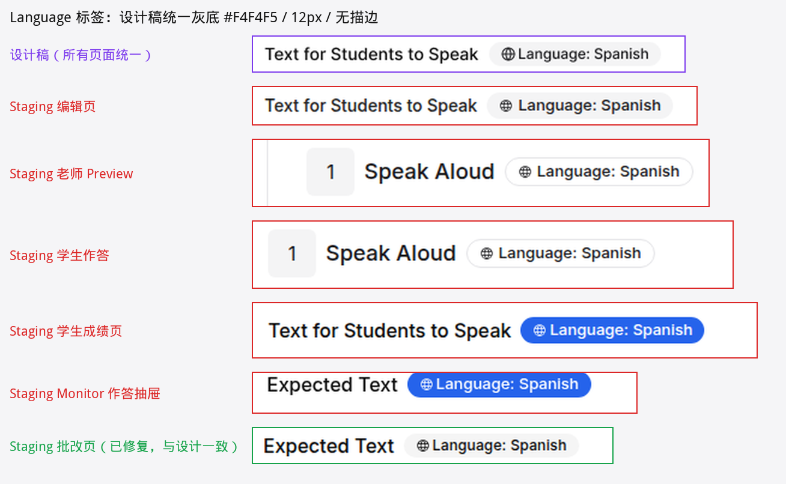

### 老师端 · 编辑页

#### #2 【中】`Text for Students to Speak` 标签字号偏小

- 现在：14px / 行高 14px，颜色 `#222`。
- 应该：Inter Medium 16px / 24px，`#0A0A0A`（APACFE-4269 修了字重，字号还没改）。
- Figma：[Speak Aloud Over 80 Words](https://www.figma.com/design/WLKOeNoCrS33jWIpbjcE9h/Question-Library?node-id=11925-47055)

#### #3 【中】Instructions 填写后文字字重偏粗

- 现在：填写后的 Instructions 是 500（Medium），看起来和目标文本一样粗。
- 应该：Instructions 是 Regular 400，只有目标文本用 Medium，两者要有层级差。

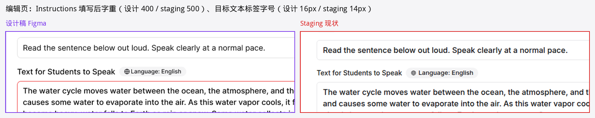

#### #4 【低】目标文本 placeholder 颜色偏深

- 现在：`Enter the exact text you want the student to say...` 颜色 `#71717A`，比上面 Instructions 的 placeholder（`#888`）深，看起来像已填内容。
- 应该：`#888`，和 Instructions placeholder 一致。
- Figma：[Speak Aloud Empty Landed](https://www.figma.com/design/WLKOeNoCrS33jWIpbjcE9h/Question-Library?node-id=11437-44297)

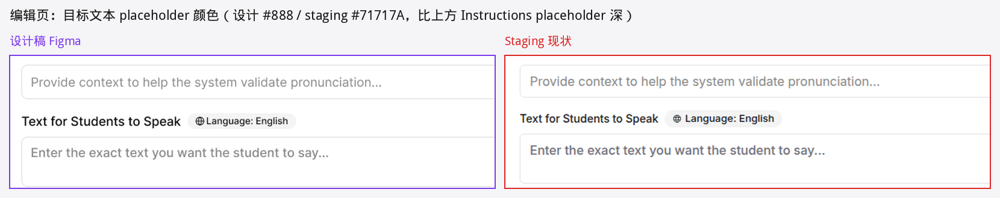

#### #5 【低】刚加的空白题卡底部没有 `No standards added yet.`

- 现在：空白题卡底部什么都没有；填完目标文本后才出现 `No standards added yet.`。
- 应该：空白题卡也显示 `No standards added yet.`（设计 Empty Landed）。点 Assign 被拦时由 `Missing expected text.` 替换。

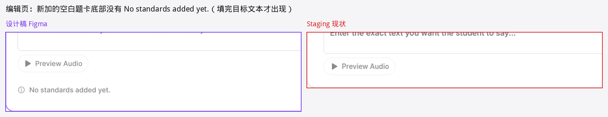

#### #6 【低】题卡底部提示 / 报错的字号和图标

- 现在：`No standards added yet.`、`Missing expected text.`、`Use 80 words or fewer...` 都是 16px / 24px，图标是感叹号圆圈（circle-alert）。
- 应该：14px / 20px Medium；提示用 Info 图标、`#888`；报错用 XCircle 图标、红色。
- 说明：报错时 staging 整张卡描边变红，设计是卡片保持选中紫边、只有目标文本输入框变红；「输入框变红」已在 APACFE-4178 取消，这里只提字号和图标。
- Figma：[Speak Aloud Assign Blocked](https://www.figma.com/design/WLKOeNoCrS33jWIpbjcE9h/Question-Library?node-id=11925-46124)

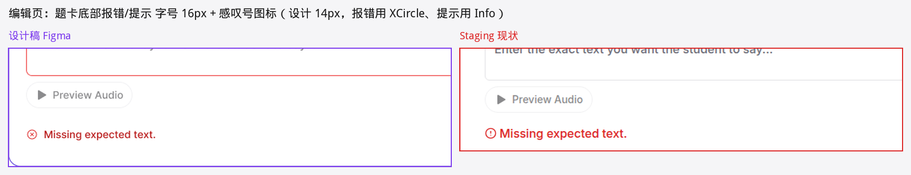

#### #7 【低 · 需确认】Question Settings 副标题和空白题默认值

- 现在：副标题 `Adjust the question settings to tailor the experience for your audience.`；新建的空白 Speak Aloud 显示 `Bloom's Taxonomy: Analyze`、`Level: Medium`。
- 设计：副标题结尾是 `for your students.`；空白题 Bloom's / Level 都是 `N/A`。
- 需确认：副标题是所有题型共用的老文案；Bloom's / Level 是否应该在老师没设置时显示 N/A。
- Figma：[Question Settings Open](https://www.figma.com/design/WLKOeNoCrS33jWIpbjcE9h/Question-Library?node-id=11491-13498)

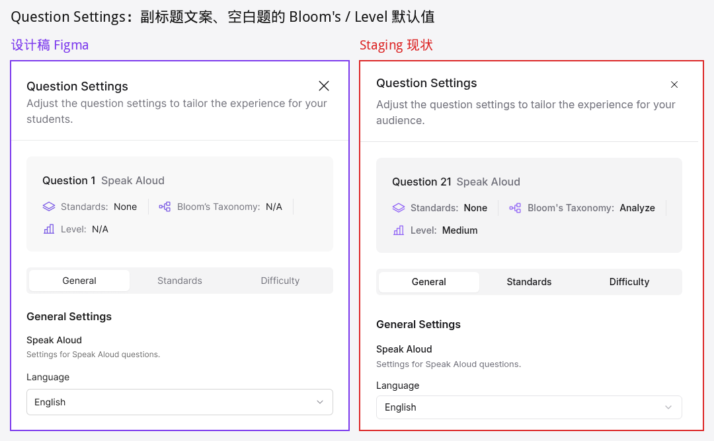

#### #8 【低】Language 下拉选中项样式

- 现在：选中项灰底 + 右侧对勾。
- 应该：选中项淡紫底、无对勾（设计 Language Open）。共用 Select 组件，可能影响其他下拉，改前确认范围。
- Figma：[Language Open](https://www.figma.com/design/WLKOeNoCrS33jWIpbjcE9h/Question-Library?node-id=11540-18763)

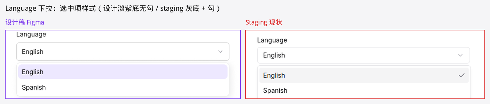

#### #9 【低】加题弹窗关闭图标偏小

- 现在：右上角 × 约 16px。
- 应该：24px（设计）。弹窗其他部分（Blank question、Speak Aloud 图标、Quantity、Add blank question）都一致。
- Figma：[Speak Aloud Type Selected](https://www.figma.com/design/WLKOeNoCrS33jWIpbjcE9h/Question-Library?node-id=11682-41469)

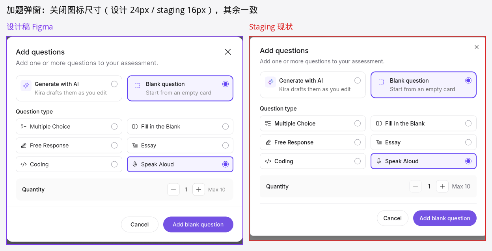

### 老师端 · Preview

#### #10 【中】点过 Try again 后麦克风被拦截，文案说「上一段录音还在」

- 现在：Preview 里先录一段 → 点 Try again → 麦克风被拦截，说明是 `Allow microphone access in your browser to record again. Your last recording is still saved.`（学生端重录的文案）。Preview 的录音不保存，这句话不成立。
- 应该：和首次被拦截一样：`Allow microphone access in your browser to answer this question. You can keep working on the other questions.`
- 说明：APACFE-4308 测的是首次被拦截，已修好；这是点过 Try again 之后的分支。
- Figma：[Teacher Preview - Microphone Blocked](https://www.figma.com/design/WLKOeNoCrS33jWIpbjcE9h/Question-Library?node-id=11788-45115)

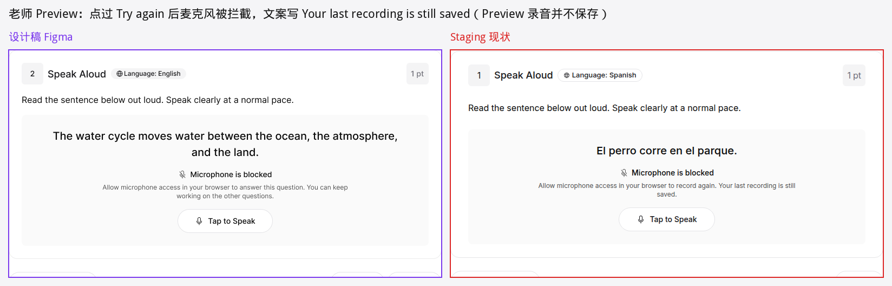

### 学生端 · 作答（Preview 共用的部分一起列）

#### #11 【低】麦克风被拦截 / 保存失败的说明文字偏小

- 现在：说明文字 12px / 16px（首次和重录、Preview 和学生端都是）。
- 应该：Inter Regular 14px / 20px，`#525252`，宽 480。
- Figma：[Microphone Blocked](https://www.figma.com/design/WLKOeNoCrS33jWIpbjcE9h/Question-Library?node-id=11521-14921) · [Re-record - Microphone Blocked](https://www.figma.com/design/WLKOeNoCrS33jWIpbjcE9h/Question-Library?node-id=12180-33589) · [Save Failed](https://www.figma.com/design/WLKOeNoCrS33jWIpbjcE9h/Question-Library?node-id=11521-14934)

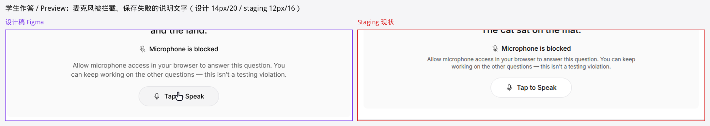

#### #12 【低 · 需确认】作答时右上角分数写法

- 现在：`1 pt`。
- 设计：学生作答的所有帧都是 `- / 1 pt`（老师 Preview 是 `1 pt`）。
- 需确认：作答中显示 `- / 1 pt` 是否是想要的（其他题型作答时只显示分值），确认后改设计或改实现。

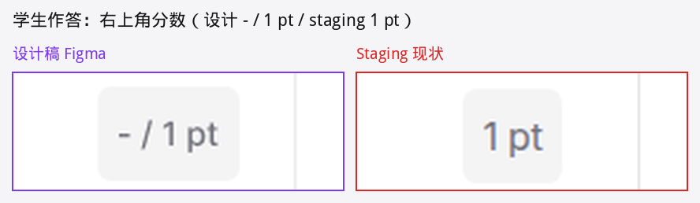

#### #13 【中】断网时录音一直停在 Processing，不能重录

- 现在：录音中断网 → 点停止 → 一直显示 `Processing...` / `Saving your recording. You can't record again until this finishes.`，等了 45 秒以上没变化，停止按钮一直转圈；页面顶部有 `Connection lost...` 提示。联网后 0.5 秒内变成 `Audio recorded`，录音补交成功。
- 应该（PRD §4.4，Figma 没有这一帧）：显示 `Recording saved on this device` / `It will be sent when you're back online.` + `Try again` 按钮，无播放器；算已作答，可以重录。
- 说明：APACFE-4288 修的是「联网后不补交」，补交现在没问题；卡在 Processing 是另一个问题。设计也需要补这一帧。

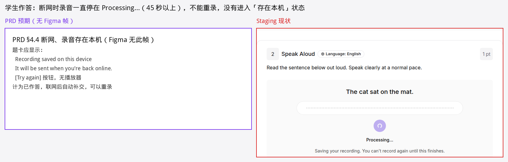

#### #14 【低】交卷确认弹窗单复数错误（老页面）

- 现在：只剩 1 道没答时显示 `You have 1 unanswered questions in this section.`
- 应该：1 道用 `question`，2 道及以上用 `questions`。

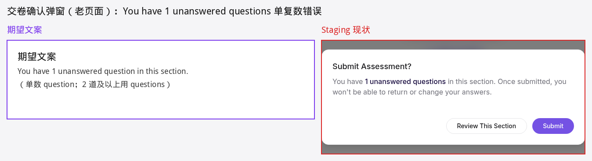

### 学生端 · 成绩页

#### #15 【中】未作答时 Your Response 区只有一行字

- 现在：`No recording was saved for this question.` 只是一行灰字（学生成绩页、Monitor 抽屉都一样）。
- 应该：放在和播放器同尺寸的灰色描边框里（高 64），左边 MicrophoneSlash 图标（设计 Audio Row / Student / Empty）。
- Figma：[Graded - Not Answered](https://www.figma.com/design/WLKOeNoCrS33jWIpbjcE9h/Question-Library?node-id=11523-17556)

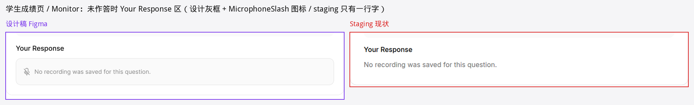

#### #16 【低】成绩页题卡间距和 Instructions 字号

- 现在：题头（题号行）到 Instructions 约 36px；Instructions 16px / 24px。
- 应该：题头到内容 16px；Instructions Regular 18px / 28px（目标文本块 18px 已一致）。
- Figma：[Graded - Full Points](https://www.figma.com/design/WLKOeNoCrS33jWIpbjcE9h/Question-Library?node-id=11521-50954)

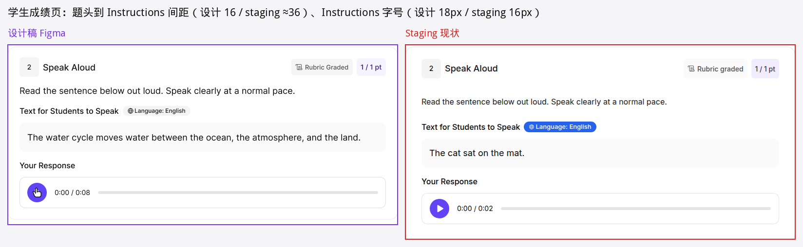

#### #17 【低 · 需确认】Grading in Progress 页文案和题号样式

- 现在：副标题 `Your assessment has been submitted. Your score will appear here automatically once grading is complete.`；Answer Record 题号是白底紫描边。
- 设计：副标题 `Your assessment has been submitted. Scores will be available after teacher review.`；题号已答是淡紫实底、未答灰底。
- 需确认：AI Grading 下几秒就出分，staging 的文案可能更准确，确认后统一设计或实现。
- Figma：[Results - Grading in Progress](https://www.figma.com/design/WLKOeNoCrS33jWIpbjcE9h/Question-Library?node-id=12054-47854)

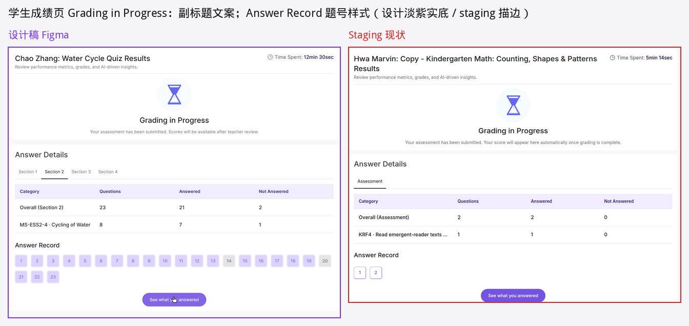

#### #18 【低 · 需确认】报告未发布时的题卡

- 现在（Manual Grading，老师未发布）：题卡上方多了蓝色提示条 `You're viewing your submitted answers. Scores, explanations, and feedback will appear here once your report is released.`；未作答的题仍显示 `Not answered` 标签。
- 设计：没有提示条；未作答只显示 `- / 1 pt`、不显示状态标签（组件说明：Report-Ungraded: no badge）。
- 需确认：提示条是不是所有题型共用的老逻辑；未发布时未作答要不要显示状态。
- Figma：[Submitted Ungraded - Not Answered](https://www.figma.com/design/WLKOeNoCrS33jWIpbjcE9h/Question-Library?node-id=11523-17523)

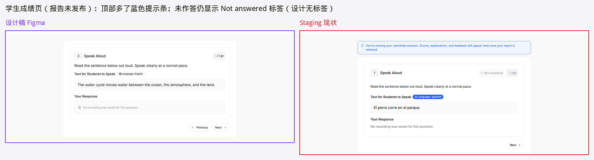

### 老师端 · Monitor 作答抽屉

#### #19 【中】抽屉里的题卡没有复用成绩页题卡

- 现在：目标文本拆成一个个灰色词块；标签写 `Expected Text`；语言标签蓝底（见 #1）；未作答空状态只有一行字（见 #15）。
- 应该（PRD §6）：和学生成绩页同一张卡：目标文本整句纯文本（灰底块，18px），标签 `Text for Students to Speak`；只有回答区标签写 `Student Response`（这一点 staging 已对）。逐词结果只在批改页看。
- Figma：抽屉复用 [Student 成绩页题卡](https://www.figma.com/design/WLKOeNoCrS33jWIpbjcE9h/Question-Library?node-id=11523-17545)

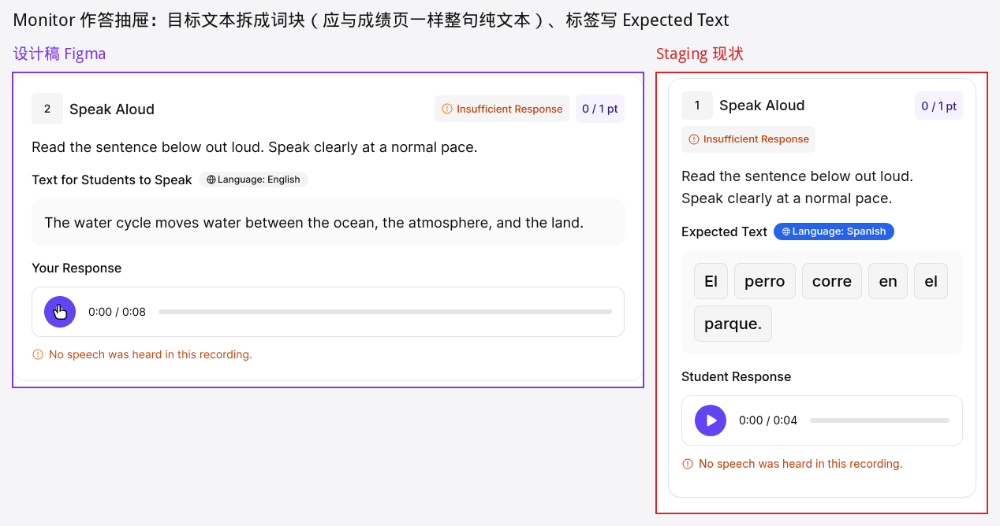

### 老师端 · 批改页

#### #20 【中】改分后出现学生口吻、选择题口吻的提示

- 现在：老师把分数从 0 改成 1 后，题卡顶部出现 `Your teacher changed this score. The answer marks still show the correct choice.`
- 问题：这是老师自己在看的页面，却写「Your teacher」；Speak Aloud 没有「choice」，标记的是逐词绿 / 红。设计改分后的帧没有这条提示。
- 应该：按设计不显示；如果要保留提示，改成老师视角、适用于 Speak Aloud 的文案（例如说明逐词颜色仍是自动评分结果），需 PM 定文案。
- Figma：[Override Score Updated](https://www.figma.com/design/WLKOeNoCrS33jWIpbjcE9h/Question-Library?node-id=11657-71004)

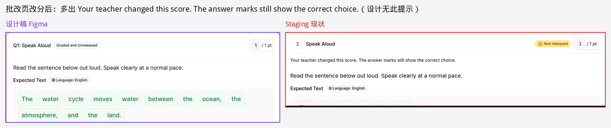

## 已提单复测

| 单 | 复测结果 |
| -- | -- |
| [APACFE-4308](https://linear.app/kira-learning/issue/APACFE-4308) Teacher Preview 处理中 / 已录 / 麦克风被拦截文案 | 已修复：处理中、已录只剩 `Preview recordings aren't saved or scored.`；首次被拦截文案正确。点过 Try again 后被拦截的分支见 #10 |
| [APACFE-4318](https://linear.app/kira-learning/issue/APACFE-4318) 批改页语言标签蓝底 | 已修复：灰底 `#F5F5F5`、12px |

## 设计稿需要同步（不是前端问题）

- **批改页未作答**：staging 显示 `Insufficient Response` 横幅 + `Insufficient response: no answer was provided.`、`0 / 1 pt`、`No audio submitted`，和 PRD §5 一致（APACPO-336 已定）；设计 [Unanswered](https://www.figma.com/design/WLKOeNoCrS33jWIpbjcE9h/Question-Library?node-id=11657-70374) 还是 `Not submitted` + `- / 1 pt`。
- **Preview Audio 加载态**：点 Preview Audio 后约 1 秒按钮显示转圈 + 置灰，再变成 Stop Audio；设计没有这一态。
- **断网存在本机**：Figma 没有这一帧（见 #13）。

## 其他观察（不在本次范围，供相关单参考）

- 状态标签大小写在同一页面前后两次加载不一样：`Grading in Progress` / `Grading in progress`、`Not Answered` / `Not answered`、`Rubric Graded` / `Rubric graded`。标签写法由 [APAC-6434](https://linear.app/kira-learning/issue/APAC-6434) 统一处理，这里只提醒「同页会变」这个现象。
- Monitor 矩阵交卷后，0 分的 Speak Aloud 格子（包括 Insufficient Response）是红色 `0`，和选择题答错同色。PRD 要求 Speak Aloud 不出现 Correct / Incorrect，是否需要区分待 PM 判断。
- 编辑页选中题卡描边是 2px `#7452E4`，设计 token 是 1px `#4F33D4`，所有题型共用。

## 和设计一致的状态

- 编辑页：加题弹窗（Blank → Speak Aloud、Quantity、Add blank question）、Spanish 题卡、Preview Audio / Stop Audio、Question Settings 只有 General → Language、`Missing expected text.` 和超过 80 词的文案。
- 老师 Preview：未录、录音中（停止图标）、处理中、已录（播放器 + Try again）、首次麦克风被拦截。
- 学生作答：未录、录音中（`Tap stop when you finish...`）、处理中、已录、播放中、点 Try again 后（`Your last recording is still saved. Record again to replace it.`）、重录成功、首次 / 重录麦克风被拦截文案、首次 / 重录保存失败文案、暂停（弹窗一致，题卡不显示 Try again）。
- 学生成绩页：Insufficient Response（标签 + `No speech was heard in this recording.`）、0 分、满分、未作答 `- / 1 pt`（按 APACPO-330 口径）、报告未发布时已作答题 `- / 1 pt` 且无标签。
- 批改页：逐词绿 / 红、Insufficient Response 时词块全灰、播放器、分数框。

## 没覆盖到的

- **自动停止**（听全所有词后自动停）：依赖浏览器语音识别，测试机上不可用，没测。
- **Needs grading**（自动评分不可用）：批改页、成绩页、Monitor 抽屉的这一态无法在 staging 人为触发。
- **真实朗读满分**：合成语音都被判 0 分，满分态是老师改分得到的。
- Safari、移动端、小屏没测。
